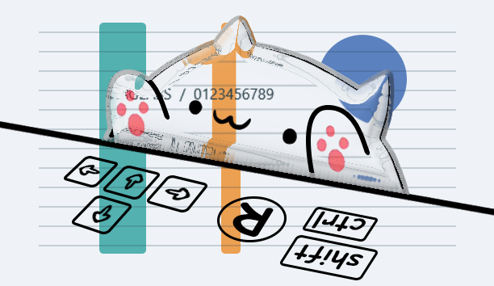
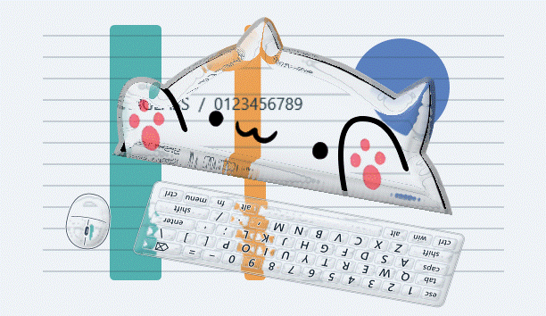

# Glass Bongo Cat

**Bongo Cat 的猫身和爪子，变成了厚而清透的液态玻璃。**



这是 Windows 桌宠：原版 Bongo Cat Mver 的猫形、五官、粉色爪垫与四种敲爪姿态，加上真正采样后方桌面的玻璃材质。玻璃沿猫耳、脸颊、身体和爪子的轮廓形成宽倒角与双层折射，内部保持清楚；默认使用较强折射。

[下载最新版本](https://github.com/Watertube-bilibili/glass-bongo-cat/releases/latest) · [版本说明](RELEASE_NOTES.md) · [验证记录](VERIFICATION.md)

## 下载与运行

在 Release 下载 `GlassBongoCat-0.1.0-win-x64.zip`，解压后双击 `GlassBongoCat.exe`。也可直接下载单文件 EXE，无需另外下载猫咪素材。需要 **Windows 10 2004+ / Windows 11，x64，.NET Framework 4.8**；系统组件不包含在 EXE 文件大小内。

默认显示在右上角，宽度 300 个 Windows 逻辑像素，设置可调到 160–480。支持拖动移动、双击设置、右键菜单和系统托盘。首次启动直接显示猫咪，不弹出设置打断当前工作。

| 操作 | 效果 |
| --- | --- |
| 打字、按键 | 对应猫爪敲下，松开后抬起 |
| 点击鼠标左右键 | 驱动猫爪 |
| 拖动猫咪 | 改变桌宠位置 |
| 双击猫咪或托盘 | 打开设置 |
| 右键猫咪或托盘 | 设置、隐藏、暂停、找回位置、退出 |
| Ctrl + Alt + G / S | 显示隐藏 / 设置 |
| Ctrl + Alt + P / Q | 暂停 / 退出；若被其他软件占用，请用托盘菜单 |

## 调整玻璃

- **折射强度**：改变背景的实际采样位移，默认 1.65。
- **玻璃厚度**：改变曲面倒角、光程和前后两层采样，默认 1.35。
- **边缘高光**：控制中性高光及暗边。
- **清透程度**：保留背景细节，默认 98%。
- **桌宠宽度**：连续缩放，并提供紧凑、标准、放大预设。



上面的动图由真实材质渲染器与原版图层在受控背景上生成，用于展示四种敲爪姿态和折射，不是桌面录屏。完整应用的帧率与边缘验证见 `VERIFICATION.md`。

## 实现与来源

猫咪来自 [MMmmmoko/Bongo-Cat-Mver](https://github.com/MMmmmoko/Bongo-Cat-Mver) 的原版键盘模式 PNG。源图保存在 `assets/cat/source`，像素分层脚本可复现玻璃遮罩与原始线条；没有使用 Grok Bot 眼形。原素材的版权、许可证及派生方式见 [来源声明](THIRD_PARTY_NOTICES.md) 和 [素材记录](assets/cat/SOURCE.md)。这不是 Steam 上 Irox Games 的 Bongo Cat 客户端，不包含其付费内容。

`GlassMaterial` 是本项目的独立材质实现：遮罩距离场构造有厚度的曲面，前后两条射线路径采样桌面；不是给白猫降低透明度。原生分层窗口负责置顶与呈现，WPF 用于离屏绘制和设置，不捆绑浏览器、Live2D 或网络服务。

## 系统边界与本地数据

实时折射会排除猫咪自身的屏幕捕获，避免递归采入自己；因此部分录屏软件看不到猫咪。“录屏可见”会切换到真实透明的高光材质，停用背景采样。

后方窗口若主动禁止捕获，重叠区域采用局部真实透明和高光，保留对方内容；不会绕过其保护，也不能真实折射该受保护区域。四条屏幕边缘与四个角使用有效采样，不会因截图被屏幕裁切而清空猫身。

普通置顶窗口不能覆盖 UAC 安全桌面或锁屏。多显示器、特殊 DPI、远程桌面、独占全屏和各种录屏软件未逐一覆盖。

正常运行无需联网。输入只保留瞬时按键/鼠标状态，不转换或存储输入文字，不注入系统键鼠操作；屏幕像素仅在本机内存中用于渲染。设置保存于 `%LOCALAPPDATA%\GlassBongoCat\settings.xml`；发生异常时，该目录可能有 `last-error.txt`。诊断参数会主动保存测试图片和性能日志。

锁屏或会话断开时暂停采样和持续绘制，正常解锁后自动恢复。发布时测试电脑处于锁屏状态，因此本版未给出正常桌面实测帧率；应用目标为 60 Hz 呈现，实际效果仍受设备与桌面捕获速度影响。

## 构建

在 64 位 Windows 上运行：

```powershell
powershell.exe -NoProfile -ExecutionPolicy Bypass -File .\build.ps1
powershell.exe -NoProfile -ExecutionPolicy Bypass -File .\package.ps1 -SkipBuild
```

使用系统 .NET Framework C# 编译器，不需要 npm、NuGet 或 .NET SDK。`build.ps1` 执行材质与集成测试，校验单文件小于 5 MiB；`package.ps1` 生成便携包、源码包和 SHA-256。集成测试仅操作不可见的自有窗口，不注入全局输入。

```powershell
.\dist\GlassBongoCat.exe --diagnostic .\artifacts\diagnostic
```

诊断使用自有背景窗口，包含原版爪部姿态切换、真实折射和约 12 秒窗口移动测量，随后自动退出；不更改正常设置。

本项目代码采用 MIT；原始美术保留其原有版权与许可。请先阅读 `THIRD_PARTY_NOTICES.md`。
